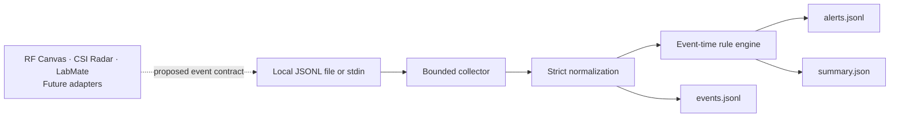

# Sauron Sentinel

**Local telemetry. Explainable detections. A foundation for an embedded security lab.**

[](https://github.com/sehmusadsoy-ui/sauron-sentinel/actions/workflows/ci.yml)
[](https://www.python.org/)
[](LICENSE)

Sauron Sentinel is a Python telemetry and detection engine for reproducible security experiments. It reads local JSON Lines records, validates and normalizes them into a common event model, then applies declarative rules with event-time windows and cooldowns. Every alert includes the rule, grouping values, and event IDs that explain it.

Version **0.1.0 is an early, working CLI release**. It has no runtime dependencies, opens no network listener, and performs no active scanning or radio transmission. Its bundled demonstration is entirely synthetic.

RF Canvas, CSI Radar, and LabMate are **planned integration targets**. This repository does not implement or validate Flipper Zero/ESP32 firmware, serial collectors, RF capture, or CSI processing. Source labels in sample telemetry describe a proposed data contract; they do not establish hardware compatibility.

## What works today

| Capability | Implementation |
| --- | --- |
| Collection | Bounded, streaming JSONL ingestion from a file or standard input |
| Normalization | Explicit schema validation, timezone-aware UTC timestamps, deterministic event IDs |
| Detection | TOML rules, typed comparisons, grouped threshold windows, cooldowns |
| Evidence | Normalized event log, alert log, and run summary in a fresh local directory |
| Reproducibility | Deterministic synthetic demo and automated regression tests |
| Resource controls | Input-size and event-count limits, bounded deduplication and correlation state |
| Delivery | Installable package, Windows/Linux CI, wheel and source-distribution checks |

This is a heuristic analysis tool, not a calibrated intrusion detector or production SIEM. RF activity and motion observations alone do not prove an attack.

## Quick start

Requires Python 3.11 or newer. Run these commands from a terminal:

```sh
git clone https://github.com/sehmusadsoy-ui/sauron-sentinel.git
cd sauron-sentinel
python -m venv .venv
```

Activate the environment:

```sh
# Linux / macOS
source .venv/bin/activate
```

```powershell
# Windows PowerShell
.venv\Scripts\Activate.ps1
```

Install and run:

```sh
python -m pip install .
sauron-sentinel --version
sauron-sentinel demo --output demo-output
```

The demonstration replays 12 fixed synthetic events through the same pipeline used by `run` and produces three alerts. Inspect `demo-output/events.jsonl`, `demo-output/alerts.jsonl`, and `demo-output/summary.json`. Choose a new output directory for each run; an existing directory is rejected to protect earlier evidence.

You can also use `python -m sauron_sentinel` in place of `sauron-sentinel`.

## Analyze your telemetry

Start with records that follow the [event contract](docs/data-format.md). Use only telemetry you are authorized to process, and remove secrets before exporting it.

```sh
sauron-sentinel validate --input examples/telemetry.jsonl
sauron-sentinel run --input examples/telemetry.jsonl --output sentinel-output
```

To receive JSONL from another local process, set `--input -`:

```sh
cat examples/telemetry.jsonl | sauron-sentinel run --input - --output stdin-output
```

PowerShell equivalent:

```powershell
Get-Content examples/telemetry.jsonl | sauron-sentinel run --input - --output stdin-output
```

Supply a custom rules file when needed:

```sh
sauron-sentinel run --input examples/telemetry.jsonl --rules examples/custom-rules.toml --output custom-output
```

`validate` checks the event schema and input limits without writing files; it does not evaluate rules or check chronological ordering. `run` requires timestamps to be ordered across the entire stream. Offset timestamps are converted to UTC. Invalid records, out-of-order events, invalid rules, and exhausted resource limits stop the run with a nonzero exit status. See the summary and command error before treating output as complete.

The default event limit is 100,000. Use `--max-events N` to choose a limit from 1 through 1,000,000; reaching an excess record causes an error rather than silent truncation. Commands print a JSON summary on success. Validation and processing errors return exit code `2`; interruption returns `130`.

## Detection examples

The bundled rules illustrate three repeatable experiments:

| Rule | Trigger | Interpretation |
| --- | --- | --- |
| `auth-failure-burst` | Five authentication failures for the same device and user in 60 seconds | Investigate repeated failures; this does not establish credential compromise |
| `rf-activity-burst` | Three RF observations with RSSI at least −40 dBm in 10 seconds | Investigate a cluster of strong observations; this is not RF attack attribution |
| `motion-without-maintenance` | Motion score at least 0.8 with `maintenance=false` | Review the observation and context; no physical-security guarantee |

Rules are intentionally small and transparent. They have no arbitrary Python expressions, shell actions, external lookups, or automatic remediation. Thresholds are demonstration values and require calibration against controlled real measurements.

See [rule semantics and configuration](docs/rules.md) for exact window, cooldown, and grouping behavior.

## Architecture



The boundary between collection and normalization allows a future adapter to export the same event schema without changing detection logic. Hardware authentication, clock synchronization, transport framing, and field validation still need to be designed and tested before live use.

Read the [architecture](docs/architecture.md), [data format](docs/data-format.md), and [security model](docs/security-model.md) for operational details.

## Development and verification

```sh
python -m pip install -e ".[dev]"
python -m ruff check .
python -m ruff format --check .
python -m pytest --cov --cov-report=term-missing
python -m build
```

CI runs the tests on Windows and Ubuntu with Python 3.11 and 3.14, enforces branch coverage, and smoke-tests a wheel installed into a clean environment. Coverage describes exercised code; it is not a measure of real-world detection accuracy.

Runtime code uses the Python standard library. Development tools and the build backend are pinned in `pyproject.toml`; transitive tooling dependencies are resolved by pip. GitHub Actions use full commit pins and read-only repository permissions. Dependabot proposes dependency updates.

## Limits and next stages

- No live hardware collectors, GUI/dashboard, service, cross-device clock correction, or network API.
- No learned anomaly model, threat-intelligence feed, Sigma compatibility, or automatic response.
- Correlation state and duplicate tracking are in memory and reset on each run. The default engine limits are 4,096 active rule groups, 100,000 evidence entries, and 10,000 cached event IDs.
- Duplicate suppression is bounded; replaying an event after its ID leaves the cache can count it again.
- Synthetic and non-synthetic events are always kept in separate rule groups. The `synthetic` flag is supplied by the producer and is not cryptographic provenance.
- Outputs contain telemetry attributes as provided. They are not encrypted, signed, anonymized, or automatically redacted.

The [roadmap](docs/roadmap.md) defines acceptance criteria for real adapters, timeline exploration, and controlled lab validation. No hardware stage is marked complete.

## Contributing and security

See [CONTRIBUTING.md](CONTRIBUTING.md) for development conventions and [SECURITY.md](SECURITY.md) for reporting a vulnerability without publishing sensitive data.

Released under the [MIT License](LICENSE). A Sauron Lab project.
