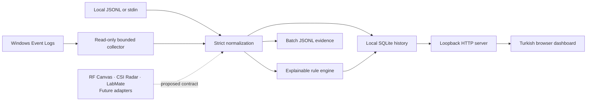

# Sauron Sentinel

**See local Windows security telemetry. Inspect the evidence behind every alert.**

[](https://github.com/sehmusadsoy-ui/sauron-sentinel/actions/workflows/ci.yml)
[](https://www.python.org/)
[](LICENSE)

Sauron Sentinel is a local Windows security-monitoring application with a Turkish desktop window, a read-only Windows Event Log collector, persistent SQLite storage, and an explainable rule engine. It shows real observations from the current computer, source availability, and alerts backed by event evidence. The same dashboard is also available through the local browser/CLI mode.

**Version 0.4.1 updates the Windows portable package for downloaded copies.** The desktop preview includes first-use source guidance, explanations for all ten bundled heuristics, per-alert review notes, persistent preferences, and optional Windows desktop notifications. The earlier read-only checkpoint is documented separately. [0.4.0 validation record](docs/validation-v0.4.md)

The portable ZIP includes Python and application dependencies, so the target computer does not need a Python installation. The desktop window uses an existing Microsoft WebView2 Runtime. The core monitoring/CLI runtime still uses the Python standard library; desktop support is an optional dependency group.

RF Canvas, CSI Radar, and LabMate remain **future integration targets**. No Flipper Zero/ESP32 firmware, serial collector, RF capture, or CSI processing is implemented in this release.

## Portable Windows app

1. Obtain the complete `Sauron-Sentinel-0.4.1-Windows-x64.zip` preview archive when available. [Release assets](https://github.com/sehmusadsoy-ui/sauron-sentinel/releases)
2. Extract the whole ZIP to a folder you can access.
3. Open the extracted `SauronSentinel` folder and double-click **`SauronSentinel.exe`**.

The extracted folder contains a single application executable and the accompanying usage and license notices. The executable unpacks its bundled support files into a temporary directory at launch. No installer, administrator prompt, autostart registration, or desktop shortcut is created. Close the window to stop its monitoring and local server.

Requires Windows 10/11 x64 with .NET Framework and the existing Microsoft Edge WebView2 Runtime. Sentinel leaves WebView2 installation to the user or administrator. The executable is unsigned, so Windows or organizational policy may warn or block it. Use the published checksum to compare your download. [Microsoft WebView2 Runtime](https://developer.microsoft.com/en-us/microsoft-edge/webview2/)

Desktop data is stored separately under `%LOCALAPPDATA%\SauronSentinel`. Upgrading from the 0.4.0 portable build reuses this history. Existing source-mode data in `sentinel-data` is left in place and is not imported automatically. [Desktop guide](docs/desktop.md)

## Run from source on Windows

Requires Python 3.11 or newer and Windows PowerShell. Download or clone the repository, then double-click **`start-sentinel.cmd`**.

This source launcher prepares a project-local `.venv` on first use, installs the CLI application, starts monitoring, and opens [the local browser dashboard](http://127.0.0.1:8765/). Keep its terminal window open; press **Ctrl+C** to stop. Initial setup may download Python build tools. Later launches reuse the installed environment without running an installation when its version matches the checkout.

You can also start it from PowerShell:

```powershell
.\Start-Sentinel.ps1
```

Choose another port or polling interval when needed:

```powershell
.\Start-Sentinel.ps1 -Port 8766 -Interval 30 -LookbackHours 24
```

The launcher does not request administrator access or change Windows audit or PowerShell execution policy. It respects the machine's existing script policy; the Python command below is also available directly. Use `-NoBrowser` to leave the browser closed, or `-Reinstall` to refresh the local installation after changing package files.

## What the dashboard shows

- Real, selected **System**, **Security**, and **Microsoft Defender** events, with timestamps and useful context.
- Source health that distinguishes an accessible log with no matching events from a log that could not be read.
- Local event and alert history retained in SQLite across restarts.
- Rule matches with event references, rather than invented incidents or a simulated attack counter.

The first-use health panel explains which sources can be read, which are unavailable or missing, and whether a result cap was reached. An accessible empty source is a successful read with no selected matches; it does not prove auditing is enabled. Previous results remain visibly stale after a failed/stopped monitor or a lost dashboard connection. Attempt/scan start and per-source last successful read times describe the current session; health is not a persisted security score. **Readable sources do not prove the computer is secure.**

The first poll looks back 24 hours by default; subsequent polls refresh the local view. The initial polling preference is 15 seconds. System lifecycle records can provide useful real observations even when security-specific channels are unavailable. **Zero alerts is a valid result.** Sentinel does not generate test attacks or fabricate events to populate the dashboard. Search and severity filters apply only to the most recent 100 events/alerts loaded in the dashboard, not the full retained history.

Healthy polls use a 120-second overlap. If any source is unavailable or fails, monitoring retries the configured rolling lookback until all sources are healthy, still subject to per-channel result caps. Late observations appear in the timeline immediately but are skipped by the current detection pass; chronological replay on restart or recovery can add historical alerts from retained records.

Windows may restrict Security or Defender log access for the current account. Missing audit configuration, disabled channels, and an empty selected-event window can also affect results. Sentinel reports these conditions; it does not elevate itself or alter logging settings. See [Windows monitoring](docs/windows-monitoring.md).

## Review, preferences, and notifications

Open an alert to read its evidence, matching conditions, possible benign causes, and safe checks. The explanation catalog covers all ten bundled rules; RF and motion examples remain offline schema demonstrations. An unknown rule receives cautious generic guidance. Explanations do not change raw alert or evidence records.

Each alert has a local review state: `new`, `reviewed`, or `expected`, with an optional note of at most 500 Unicode characters. The choice applies only to that alert and never suppresses later similar matches. Notes and review times persist across restarts. **Unread and review are separate:** opening evidence successfully triggers an explicit mark-as-read request; changing review state does not mark it read. A failed read update remains visible and can be retried.

Preferences persist in the same local store. Defaults are notifications **off**, minimum severity **medium**, and a **15-second** scan interval. The dashboard offers 15, 30, 60, or 300 seconds and preserves a valid saved custom interval. The direct `serve` command reuses the saved interval when `--interval` is omitted; an explicit integer from 5 through 3,600 changes and saves it. The PowerShell launcher always passes its `-Interval` value, which defaults to 15, and therefore saves that override.

Native notifications are optional and available only while the desktop window and its notification adapter are running. Initial history, the first collection batch (even with partial access), historical arrivals, and restart/recovery replay do not generate new unread/notification storms. Later eligible alerts become unread independently of the notification preference. After explicit opt-in, an eligible alert at or above the selected severity can request a fixed generic Windows notification with no event, account, service, or note content. A durable attempt claim prevents repeats after restart; a failed or interrupted attempt is not retried. `queued` means accepted by the application queue, **not delivered**; Windows may suppress display. The test control is clearly labeled as a test, creates no alarm, and also requires opt-in.

The notification icon supports the open window; it is not a tray-resident background service. Closing the window stops monitoring, notifications, and the local server. Browser mode retains in-app unread/review features but reports native notifications unavailable.

## Capabilities

| Capability | Implementation |
| --- | --- |
| Windows collection | Read-only, bounded `Get-WinEvent` queries for selected event IDs |
| Portable desktop | Windowed Windows x64 application, no Python installation required on the target |
| Browser dashboard | Turkish local interface bound to IPv4 loopback |
| Persistence | Local SQLite event and alert history |
| JSONL analysis | Streaming file/stdin ingestion with strict schema validation |
| Normalization | UTC timestamps, explicit synthetic provenance, deterministic event IDs |
| Detection | TOML rules, typed comparisons, grouped event-time thresholds, cooldowns |
| Evidence and review | Immutable alert evidence, explanation catalog, persistent per-alert status/notes, separate unread flags |
| Preferences | Local schema-1 preferences and optional window-scoped Windows notification attempts |
| Verification | Automated tests and CI configuration; separate native/manual release gates |

This is an early heuristic monitoring tool, not a calibrated intrusion detector, endpoint protection replacement, or production SIEM. A matched rule is a reason to investigate, not proof of compromise.

## Manual installation and commands

```sh
git clone https://github.com/sehmusadsoy-ui/sauron-sentinel.git
cd sauron-sentinel
python -m venv .venv
```

Activate the environment with `.venv\Scripts\Activate.ps1` in Windows PowerShell or `source .venv/bin/activate` on Linux/macOS, then install:

```sh
python -m pip install .
sauron-sentinel --version
```

Start live monitoring on Windows:

```sh
sauron-sentinel serve --port 8765 --data-dir sentinel-data --lookback-hours 24 --open-browser
```

The dashboard listens only on `127.0.0.1`; LAN/public binding is not supported. Local history is stored under `sentinel-data`. Stop the process before moving or removing that directory. Keep its contents private and out of Git.

For a source-based desktop launch on Windows, install the optional desktop group and run its GUI entry point:

```sh
python -m pip install ".[desktop]"
sauron-sentinel-desktop
```

The desktop edition selects an available loopback port automatically and uses the per-user data directory described above. It enforces one running desktop instance for that user data location.

Restart/recovery replay saves previously missing alert matches without overwriting existing alert records. This also recovers a stop between committing an event and saving its alert, as long as the event is retained. A database-access error is reported without automatically resetting the existing database.

Existing supported SQLite schema 0/1 stores upgrade transactionally to schema 2 by adding local review/preferences/unread/notification metadata. Existing alert payloads and evidence are preserved; pre-existing alerts start read. Stop Sentinel and keep a private backup before upgrading a store you need to retain.

Collect a one-time Windows snapshot without starting the dashboard:

```sh
sauron-sentinel collect-windows --output windows-output --since-hours 24 --limit 200
```

Windows collection requires Windows; JSONL analysis and the synthetic demo also work on Linux/macOS. You can use `python -m sauron_sentinel` in place of `sauron-sentinel`.

## Offline analysis and reproducible demo

To verify the analysis pipeline with fixed synthetic observations:

```sh
sauron-sentinel demo --output demo-output
```

The demo processes 12 synthetic events and produces three alerts. It uses the same normalization and rule engine as file analysis. Every demo event is labeled synthetic; it is separate from live Windows monitoring.

Analyze JSONL records that follow the [event contract](docs/data-format.md):

```sh
sauron-sentinel validate --input examples/telemetry.jsonl
sauron-sentinel run --input examples/telemetry.jsonl --output sentinel-output
sauron-sentinel run --input examples/telemetry.jsonl --rules examples/custom-rules.toml --output custom-output
```

Batch analysis writes `events.jsonl`, `alerts.jsonl`, and `summary.json` into a new directory. An existing output directory is rejected to protect prior evidence. A failed run can leave partial files with `status=failed` in its summary.

`validate` checks the schema and input limits without writing files; it does not evaluate rules or check chronological ordering. `run` requires timestamps in globally nondecreasing order. Both accept `--input -` for standard input. The default batch event limit is 100,000; `--max-events N` accepts 1–1,000,000 and fails on excess input instead of silently truncating it.

## Detection and evidence

Rules operate on normalized events, maintain bounded per-group evidence, and use event time. Alerts identify their rule, severity, grouping values, and contributing event IDs. Synthetic and non-synthetic records cannot combine to meet a threshold.

Windows baseline rules flag service installation, audit-log clearing, Defender threat/disable records, account creation, group membership changes, and unexpected shutdowns for investigation. These records can also reflect legitimate administration or operational faults. Authentication failures use a grouped threshold rather than declaring every failure an incident.

The original demonstration rules include repeated authentication failures, clusters of strong RF observations, and motion outside a declared maintenance period. RF and motion rules are schema demonstrations; they do not implement radio or CSI acquisition and cannot establish attack intent. Thresholds require calibration against labeled, authorized captures.

See [rules](docs/rules.md) for exact comparison, window, grouping, and cooldown semantics.

## Architecture



Read the [architecture](docs/architecture.md), [Windows collector guide](docs/windows-monitoring.md), [event contract](docs/data-format.md), and [security model](docs/security-model.md).

## Privacy and operational limits

- Runtime monitoring stays on the local machine. It performs no active scanning, radio transmission, automatic response, or telemetry upload.
- The local dashboard has no user-account system or TLS. Loopback binding is a deployment boundary, not protection against other software or users already on the computer.
- Events can contain account names, service names, threat labels, and other sensitive context. Local database, review notes, and export files are plaintext; review data before sharing it. Live exports add review/unread metadata and local state without rewriting raw alert/evidence records.
- Selected event IDs and per-channel result limits mean collection is not a complete Windows audit archive. Source status flags possible capped results.
- Missing permissions and missing logs remain visible limitations. The application does not grant itself access, change audit policy, or manufacture replacement data.
- There are no validated RF Canvas, CSI Radar, LabMate, Flipper Zero, or ESP32 integrations.
- No learned anomaly model, threat-intelligence feed, Sigma compatibility, or remediation system is included.

See the [roadmap](docs/roadmap.md) for the remaining stages.

## Development and verification

```sh
python -m pip install -e ".[dev]"
python -m ruff check .
python -m ruff format --check .
python -m pytest --cov --cov-report=term-missing
python -m build
```

CI is configured for Windows and Ubuntu with Python 3.11 and 3.14, branch coverage, and an installed-wheel smoke test. On 2026-11-06, the Phase 5 local source check passed **449 tests, with 1 expected Windows symlink skip and 93.61% branch-measured coverage**, plus Ruff lint/format, JavaScript syntax, and the Phase 2/3 DOM checks. This does not establish that every candidate CI job passed. The [read-only validation record](docs/validation-v0.4.md) preserves the earlier inherited 448-test checkpoint and actual partial access on the current PC with deduplication/replay evidence. That checkpoint does not establish controlled Windows scenarios, clean-machine installation, or native GUI/Save As/notification appearance and lifecycle. Host-specific unit tests use synthetic operating-system responses. Coverage is not a real-world detection-accuracy metric.

Core monitoring and CLI code use the standard library. The optional desktop edition uses pywebview, Python/.NET interoperability, and Microsoft's installed WebView2 Runtime. Desktop build tools and top-level development dependencies are pinned in `pyproject.toml`; pip resolves transitive dependencies. The separate manual Windows packaging workflow builds a portable artifact without collecting live user data. Actions use full commit pins and read-only repository permissions. Dependabot proposes updates.

See [CONTRIBUTING.md](CONTRIBUTING.md) and [SECURITY.md](SECURITY.md). Released under the [MIT License](LICENSE). A Sauron Lab project.
