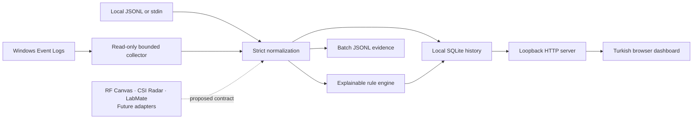

# Sauron Sentinel

**See local Windows security telemetry. Inspect the evidence behind every alert.**

[](https://github.com/sehmusadsoy-ui/sauron-sentinel/actions/workflows/ci.yml)
[](https://www.python.org/)
[](LICENSE)

Sauron Sentinel is a local Windows security-monitoring application with a Turkish desktop window, a read-only Windows Event Log collector, persistent SQLite storage, and an explainable rule engine. It shows real observations from the current computer, source availability, and alerts backed by event evidence. The same dashboard is also available through the local browser/CLI mode.

**Version 0.3.0 adds a portable Windows desktop edition.** Its ZIP includes Python and application dependencies, so the target computer does not need a Python installation. The desktop window uses an existing Microsoft WebView2 Runtime. The core monitoring/CLI runtime still uses the Python standard library; desktop support is an optional dependency group.

RF Canvas, CSI Radar, and LabMate remain **future integration targets**. No Flipper Zero/ESP32 firmware, serial collector, RF capture, or CSI processing is implemented in this release.

## Portable Windows app

1. Get `Sauron-Sentinel-0.3.0-Windows-x64.zip` from the [release assets](https://github.com/sehmusadsoy-ui/sauron-sentinel/releases).
2. Extract the whole ZIP to a folder you can access.
3. Open the extracted `SauronSentinel` folder and double-click **`SauronSentinel.exe`**.

Keep the application files together; moving only the executable will break the portable edition. No installer, administrator prompt, autostart registration, or desktop shortcut is created. Close the window to stop its monitoring and local server.

Requires Windows 10/11 x64 and the [Microsoft WebView2 Runtime](https://developer.microsoft.com/en-us/microsoft-edge/webview2/). Sentinel does not automatically download or install that runtime. The executable is unsigned, so Windows may display an unknown-publisher warning. Use the published checksum to compare your download; a checksum does not replace a publisher signature.

Desktop data is stored separately under `%LOCALAPPDATA%\SauronSentinel`, outside the extracted application folder. The ZIP contains application code/resources, not your monitoring history. Existing source-mode data in `sentinel-data` is left in place and is not imported automatically. See the [desktop guide](docs/desktop.md) for requirements, data locations, and building the portable edition.

## Run from source on Windows

Requires Python 3.11 or newer and Windows PowerShell. Download or clone the repository, then double-click **`start-sentinel.cmd`**.

This source launcher prepares a project-local `.venv` on first use, installs the CLI application, starts monitoring, and opens [the local browser dashboard](http://127.0.0.1:8765/). Keep its terminal window open; press **Ctrl+C** to stop. Initial setup may download Python build tools. Later launches reuse the installed environment without running an installation when its version matches the checkout.

You can also start it from PowerShell:

```powershell
.\Start-Sentinel.ps1
```

Choose another port or polling interval when needed:

```powershell
.\Start-Sentinel.ps1 -Port 8766 -Interval 30 -LookbackHours 24
```

The launcher does not request administrator access or change Windows audit or PowerShell execution policy. It respects the machine's existing script policy; the Python command below is also available directly. Use `-NoBrowser` to leave the browser closed, or `-Reinstall` to refresh the local installation after changing package files.

## What the dashboard shows

- Real, selected **System**, **Security**, and **Microsoft Defender** events, with timestamps and useful context.
- Source health that distinguishes an accessible log with no matching events from a log that could not be read.
- Local event and alert history retained in SQLite across restarts.
- Rule matches with event references, rather than invented incidents or a simulated attack counter.

The first poll looks back 24 hours by default; subsequent polls refresh the local view. The default polling interval is 15 seconds. System lifecycle records can provide useful real observations even when security-specific channels are unavailable. **Zero alerts is a valid result.** Sentinel does not generate test attacks or fabricate events to populate the dashboard.

Healthy polls use a 120-second overlap. If any source is unavailable or fails, monitoring retries the configured rolling lookback until all sources are healthy, still subject to per-channel result caps. Late observations appear in the timeline immediately but are skipped by the current detection pass; chronological replay on restart or recovery can add historical alerts from retained records.

Windows may restrict Security or Defender log access for the current account. Missing audit configuration, disabled channels, and an empty selected-event window can also affect results. Sentinel reports these conditions; it does not elevate itself or alter logging settings. See [Windows monitoring](docs/windows-monitoring.md).

## Capabilities

| Capability | Implementation |
| --- | --- |
| Windows collection | Read-only, bounded `Get-WinEvent` queries for selected event IDs |
| Portable desktop | Windowed Windows x64 application, no Python installation required on the target |
| Browser dashboard | Turkish local interface bound to IPv4 loopback |
| Persistence | Local SQLite event and alert history |
| JSONL analysis | Streaming file/stdin ingestion with strict schema validation |
| Normalization | UTC timestamps, explicit synthetic provenance, deterministic event IDs |
| Detection | TOML rules, typed comparisons, grouped event-time thresholds, cooldowns |
| Evidence | Alert references and evidence snapshots; JSONL batch exports |
| Verification | Automated tests, Windows/Ubuntu CI, wheel and source-distribution checks |

This is an early heuristic monitoring tool, not a calibrated intrusion detector, endpoint protection replacement, or production SIEM. A matched rule is a reason to investigate, not proof of compromise.

## Manual installation and commands

```sh
git clone https://github.com/sehmusadsoy-ui/sauron-sentinel.git
cd sauron-sentinel
python -m venv .venv
```

Activate the environment with `.venv\Scripts\Activate.ps1` in Windows PowerShell or `source .venv/bin/activate` on Linux/macOS, then install:

```sh
python -m pip install .
sauron-sentinel --version
```

Start live monitoring on Windows:

```sh
sauron-sentinel serve --port 8765 --data-dir sentinel-data --interval 15 --lookback-hours 24 --open-browser
```

The dashboard listens only on `127.0.0.1`; LAN/public binding is not supported. Local history is stored under `sentinel-data`. Stop the process before moving or removing that directory. Keep its contents private and out of Git.

For a source-based desktop launch on Windows, install the optional desktop group and run its GUI entry point:

```sh
python -m pip install ".[desktop]"
sauron-sentinel-desktop
```

The desktop edition selects an available loopback port automatically and uses the per-user data directory described above. It enforces one running desktop instance for that user data location.

Restart/recovery replay saves previously missing alert matches without overwriting existing alert records. This also recovers a stop between committing an event and saving its alert, as long as the event is retained. A database-access error is reported without automatically resetting the existing database.

Collect a one-time Windows snapshot without starting the dashboard:

```sh
sauron-sentinel collect-windows --output windows-output --since-hours 24 --limit 200
```

Windows collection requires Windows; JSONL analysis and the synthetic demo also work on Linux/macOS. You can use `python -m sauron_sentinel` in place of `sauron-sentinel`.

## Offline analysis and reproducible demo

To verify the analysis pipeline with fixed synthetic observations:

```sh
sauron-sentinel demo --output demo-output
```

The demo processes 12 synthetic events and produces three alerts. It uses the same normalization and rule engine as file analysis. Every demo event is labeled synthetic; it is separate from live Windows monitoring.

Analyze JSONL records that follow the [event contract](docs/data-format.md):

```sh
sauron-sentinel validate --input examples/telemetry.jsonl
sauron-sentinel run --input examples/telemetry.jsonl --output sentinel-output
sauron-sentinel run --input examples/telemetry.jsonl --rules examples/custom-rules.toml --output custom-output
```

Batch analysis writes `events.jsonl`, `alerts.jsonl`, and `summary.json` into a new directory. An existing output directory is rejected to protect prior evidence. A failed run can leave partial files with `status=failed` in its summary.

`validate` checks the schema and input limits without writing files; it does not evaluate rules or check chronological ordering. `run` requires timestamps in globally nondecreasing order. Both accept `--input -` for standard input. The default batch event limit is 100,000; `--max-events N` accepts 1–1,000,000 and fails on excess input instead of silently truncating it.

## Detection and evidence

Rules operate on normalized events, maintain bounded per-group evidence, and use event time. Alerts identify their rule, severity, grouping values, and contributing event IDs. Synthetic and non-synthetic records cannot combine to meet a threshold.

Windows baseline rules flag service installation, audit-log clearing, Defender threat/disable records, account creation, group membership changes, and unexpected shutdowns for investigation. These records can also reflect legitimate administration or operational faults. Authentication failures use a grouped threshold rather than declaring every failure an incident.

The original demonstration rules include repeated authentication failures, clusters of strong RF observations, and motion outside a declared maintenance period. RF and motion rules are schema demonstrations; they do not implement radio or CSI acquisition and cannot establish attack intent. Thresholds require calibration against labeled, authorized captures.

See [rules](docs/rules.md) for exact comparison, window, grouping, and cooldown semantics.

## Architecture



Read the [architecture](docs/architecture.md), [Windows collector guide](docs/windows-monitoring.md), [event contract](docs/data-format.md), and [security model](docs/security-model.md).

## Privacy and operational limits

- Runtime monitoring stays on the local machine. It performs no active scanning, radio transmission, automatic response, or telemetry upload.
- The local dashboard has no user-account system or TLS. Loopback binding is a deployment boundary, not protection against other software or users already on the computer.
- Events can contain account names, service names, threat labels, and other sensitive context. Local database and export files are plaintext; review data before sharing it.
- Selected event IDs and per-channel result limits mean collection is not a complete Windows audit archive. Source status flags possible capped results.
- Missing permissions and missing logs remain visible limitations. The application does not grant itself access, change audit policy, or manufacture replacement data.
- There are no validated RF Canvas, CSI Radar, LabMate, Flipper Zero, or ESP32 integrations.
- No learned anomaly model, threat-intelligence feed, Sigma compatibility, or remediation system is included.

See the [roadmap](docs/roadmap.md) for the remaining stages.

## Development and verification

```sh
python -m pip install -e ".[dev]"
python -m ruff check .
python -m ruff format --check .
python -m pytest --cov --cov-report=term-missing
python -m build
```

CI tests Windows and Ubuntu with Python 3.11 and 3.14, enforces branch coverage, and smoke-tests an installed wheel. Host-specific collection tests use synthetic operating-system responses; a live smoke check separately verifies the current computer's accessible channels. Coverage is not a real-world detection-accuracy metric.

Core monitoring and CLI code use the standard library. The optional desktop edition uses pywebview, Python/.NET interoperability, and Microsoft's installed WebView2 Runtime. Desktop build tools and top-level development dependencies are pinned in `pyproject.toml`; pip resolves transitive dependencies. The separate manual Windows packaging workflow builds a portable artifact without collecting live user data. Actions use full commit pins and read-only repository permissions. Dependabot proposes updates.

See [CONTRIBUTING.md](CONTRIBUTING.md) and [SECURITY.md](SECURITY.md). Released under the [MIT License](LICENSE). A Sauron Lab project.
