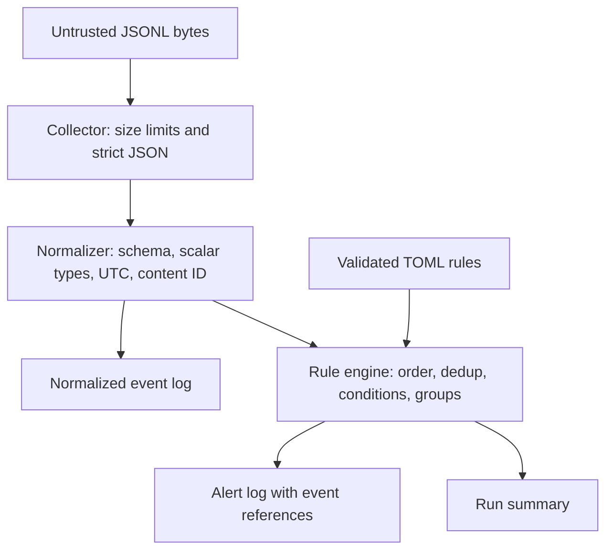

# Architecture

Sauron Sentinel v0.1.0 is a local batch/stream CLI. Its trust boundary begins at an untrusted JSONL record and ends at local files owned by the person running the command. It does not acquire radio data, authenticate a sensor, or infer that a source name corresponds to a real device.

## Data flow

Each stage has one responsibility:

1. **Collection** reads one bounded line at a time from a local file or standard input. No unbounded whole-file JSON parse is required.
2. **Normalization** rejects ambiguous or unsupported data, converts aware timestamps to UTC, and derives content-based event identifiers.
3. **Detection** evaluates fixed operators over validated fields. Sliding windows use event time, so replay does not depend on wall-clock speed.
4. **Output** persists normalized records, alerts, and a summary in a new directory. Existing evidence is not overwritten.

The package includes its own default rules and demo data so an installed wheel can run without a checkout.

## Ordering, identity, and replay

The input stream must be globally nondecreasing in event time. This deliberately avoids implicit buffering, arbitrary lateness tolerances, and silent sorting. A future multi-device collector will need an explicit clock and lateness policy before it can merge observations safely.

The event identifier is derived from canonical normalized content. An identical normalized event has an identical ID. This provides deterministic references, not authenticity: a malicious producer can forge event content and labels.

Duplicate tracking is bounded to 10,000 event IDs by default. It is an in-memory replay aid rather than a durable exactly-once delivery guarantee. Correlation and deduplication state reset for each run.

## Rule state

Each rule maintains state by its configured group fields, with synthetic provenance always included in the grouping boundary. A small deque holds the evidence needed to satisfy the threshold. Cooldowns prevent repeated alerts for the same active group. Expired state is pruned as event time advances.

The default engine caps active groups at 4,096 and retained evidence entries at 100,000. It fails closed when capacity is exhausted. This prevents silent replacement of still-relevant evidence. Thresholds, time windows, rule counts, and input sizes also have explicit bounds. These bounds reduce accidental resource exhaustion; they are not a substitute for process-level limits when processing adversarial files.

## Future adapter boundary

| Target | Intended observation family | Status |
| --- | --- | --- |
| RF Canvas / Flipper Zero | Passive RF observations and RSSI metadata | Proposed; no collector or compatibility validation |
| CSI Radar / ESP32 | Motion observations derived by the producer | Proposed; no CSI or firmware integration |
| LabMate | GPIO/UART/digital signal observations | Proposed; no serial transport or device protocol |

An adapter will be responsible for transport framing, bounded reads, device identity, consent, clock discipline, units, calibration, explicit data provenance, and a mapping to the common schema. Sentinel must continue to treat adapter output as untrusted input.

No changes to those existing projects are required by this release. Their names describe the intended ecosystem only.

## Deliberate scope

There is no daemon, web server, dashboard, database, cloud account, telemetry upload, plugin execution system, or automatic response path. Persistent storage is append-only JSONL within each new run directory. These choices keep the first release inspectable and reproducible while the event and detection contracts are exercised.
