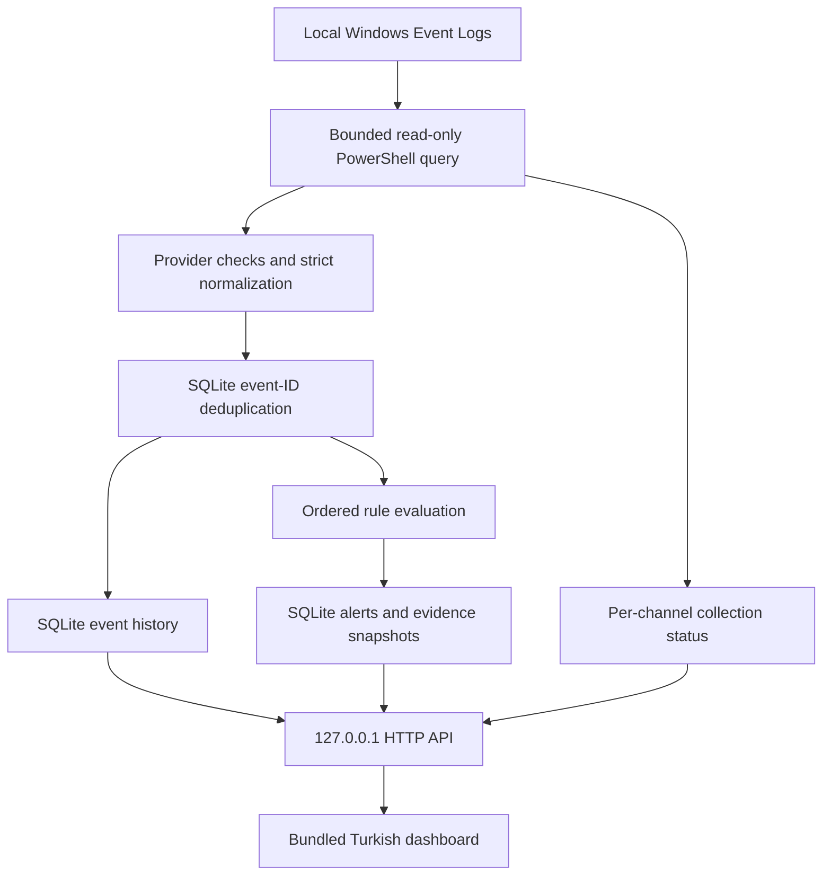
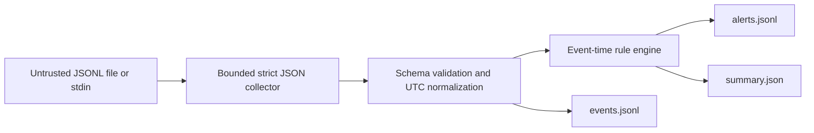

# Architecture

Sauron Sentinel v0.4.1 includes a portable Windows desktop app, persistent local browser monitoring, and a strict JSONL batch-analysis CLI. All share the normalized event contract and declarative rule engine. None acquires radio data or authenticates external sensors. The earlier read-only checkpoint covers v0.4.0. [Validation record](validation-v0.4.md)

## Desktop lifecycle

The optional pywebview host opens the bundled dashboard through EdgeChromium/WebView2. It starts the existing monitor/server on a dynamically selected IPv4 loopback port. A per-user instance lock prevents two desktop copies from intentionally opening the same data directory. Window closure stops monitoring and notifications and closes the local server/database. The notification icon belongs to this window's lifecycle; there is no background service or autostart registration.

Desktop mode stores state under `%LOCALAPPDATA%\SauronSentinel`; browser/CLI mode retains its `--data-dir` option and `sentinel-data` default. Existing repository data is not automatically migrated. The portable package includes runtime code/resources and Python dependencies, while the machine must already provide WebView2. See the [desktop guide](desktop.md).

## Live monitoring flow

The collector uses selected event IDs from System, Security, and Defender Operational logs. It reads with the current user's permissions and never elevates itself, changes audit policy, or creates events to make the dashboard appear active.

The first scan defaults to a 24-hour lookback, capped at 200 newest matching records per channel. When every source is healthy, later scans overlap the previous scan-start time by 120 seconds. If any source is unavailable or reports an error, the monitor retries its configured rolling lookback until all sources are healthy. Every retry still respects per-channel result caps and their limit flags. Stable normalized IDs prevent recollected retained events from being inserted twice.

New observations are sorted by event time before detection. If a newly discovered event is older than the engine watermark, it is immediately retained in the timeline and counted as late, but does not contribute to that live detection pass. Chronological replay during restart or recovery can subsequently produce historical alerts from those retained records. The live pass does not silently rewind its engine. Delays, access failures, and capped queries can still cause missed observations.

## Persistent state

`sentinel-data/sentinel.db` is a local SQLite database. Default retention is 20,000 normalized real events and 2,000 alerts. Old rows are pruned; this is bounded monitoring history rather than a complete audit archive. A fresh batch remains available until its alert evidence has been snapshotted, before event pruning. Alert records retain those snapshots so their explanation does not depend solely on the event-retention window.

On restart, and during recovery after a processing failure, the engine replays retained events chronologically. Matching alerts are saved with insert-if-absent semantics: existing alert IDs are not overwritten, and previously missing matches can be recovered. This covers a stop between an event commit and its alert insert while the event is still retained. Replay can also add historical alerts involving late records. It does not rewrite earlier alert evidence or recover events no longer present.

Correlation beyond retained history is not durable. Event IDs prevent duplicate insertion while their records remain in the database; retention means this is not an unlimited exactly-once guarantee. SQLite errors are reported concisely by the CLI without automatically deleting or resetting an existing database.

Dashboard lists show at most the most recent 100 records. A local export is bounded to 10,000 events and 2,000 alerts. An export is a snapshot of retained data, not a promise that every Windows event was collected.

SQLite `user_version` 0/1 upgrades transactionally to schema 2 with additive metadata tables. Existing alert payloads and evidence snapshots are not rewritten. Reviews store `new`/`reviewed`/`expected`, an optional 500-Unicode-character note, and an update time per alert. Preference payloads use strict schema 1: notifications off, medium minimum severity, and a 15-second interval by default. Invalid saved preferences reset to these defaults with an explicit `reset_invalid` status. Review and notification rows are pruned when their alert is pruned.

Unread flags are separate from review state and persist across restarts. Existing alerts and restart/recovery matches are read by default. The initial collection establishes a read baseline even when access is partial. Only newly inserted later alerts at or after session start become unread. The dashboard performs an explicit idempotent read POST after evidence has loaded; evidence GETs and review saves do not mark an alert read. Live state/export alert objects add `review` and `unread`; the evidence endpoint returns those alongside the unchanged raw alert/events and a separate versioned explanation. This local metadata is not rule input or an allowlist.

## Health and notification state

Health is computed from the current monitor session, not a stored security assessment. Expected channels with no result remain pending. Successful empty queries, unavailable sources, errors, and result caps remain distinct. `ready` requires all configured channels to report successful uncapped queries; it cannot establish complete auditing or security. `last_attempt_at` and `last_scan_at` describe the attempted/completed scan's start, while source `last_success_at` is the successful query completion time for this session. Failed/stopped monitoring marks prior source results non-current; connection loss is also surfaced by the dashboard.

Direct CLI monitoring accepts an optional interval: omitted means the saved preference, explicit means validate and persist an integer from 5 through 3,600 seconds. Preference changes wake the monitor and apply the saved interval. The PowerShell launcher supplies its own explicit interval (15 by default).

Desktop notifications use a Windows Forms `NotifyIcon` and timer on the existing window's GUI thread. The adapter queues/coalesces only two kinds of fixed generic text, regular and clearly labeled test; evidence, identifiers, and notes never cross into shell text. Initial history, historical arrivals, and replay do not notify. Later eligible bundled alerts require opt-in, severity eligibility, and an available adapter. A durable per-alert attempt claim is committed before calling the adapter and is never retried after failure or restart. This favors preventing duplicate notifications over guaranteed delivery. `queued` is queue acceptance, not a delivery receipt; Windows may suppress a notification. Browser mode has no native adapter. The test action requires opt-in and creates no alert.

## Local web boundary

The server binds to IPv4 loopback `127.0.0.1`. No command-line option enables a LAN or public bind. Browser mode uses its requested port; desktop mode chooses an available port. Bundled HTML, CSS, and JavaScript avoid external asset requests. Host/Origin validation and a session token protect browser request boundaries. There is no account system, TLS, cloud backend, or remote deployment mode.

These controls do not isolate data from malicious local processes or another user with access to the workstation. The security model remains a trusted local computer.

## Batch flow

Batch output requires a new directory. Files are never silently overwritten. Correlation and bounded duplicate-tracking state reset for each batch run. Batch inputs must be globally nondecreasing in event time; unlike live polling, out-of-order batch input is an error.

## Identity and rule state

Event IDs hash canonical normalized content. They provide deterministic references, not authenticity. Producer/source labels and synthetic flags remain claims. Live storage rejects synthetic observations; the separate demo intentionally marks all its events synthetic.

Rule groups always separate synthetic and non-synthetic provenance. Threshold evidence is bounded to the most recent required matches per group. Default engine caps are 4,096 active groups, 100,000 evidence entries, and 10,000 cached IDs. Capacity exhaustion stops evaluation instead of evicting still-active state silently.

## Future hardware boundary

| Target | Intended observation family | Status |
| --- | --- | --- |
| RF Canvas / Flipper Zero | Passive RF observations and RSSI metadata | Proposed; no collector or compatibility validation |
| CSI Radar / ESP32 | Producer-derived motion observations | Proposed; no CSI or firmware integration |
| LabMate | GPIO/UART/digital signal observations | Proposed; no serial transport or device protocol |

Adapters still need bounded framing, device identity, clock discipline, calibration, units, provenance, and real hardware tests. The existing hardware projects are not modified by this release. The live Windows collector does not imply any RF or embedded-device integration is complete.
